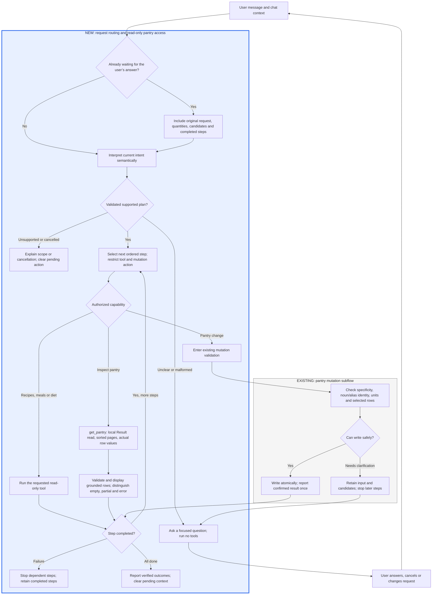

# Assistant requests and pantry identity

## Request routing and local reads

The Assistant interprets the current message with relevant conversation context
before executing tools. A separate semantic routing call returns a validated,
ordered plan; each step exposes only its intended tool. The execute handler also
checks the tool and, for pantry mutations, the specific action. Missing or
malformed plans ask a clarification question and authorize no tools. This adds a
model call and latency; it bounds execution capabilities but does not prove a
model's semantic interpretation is correct.

The blue rectangle frames the new routing and read flow. Ingredient validation
and atomic writes remain a separate existing subflow below it.

- Supported writes are adding, removing, correcting a name and explicitly merging
  compatible entries. Each planned mutation executes at most once in its step.
- Pantry description/presence checks use `get_pantry`; recipe suggestions,
  unsaved meal plans and diet analysis use their own read-only tools. Clearing or
  creating an entire pantry and saving a calendar plan remain unsupported.
- Negation, quoted recipe instructions and questions about app use do not grant
  write permission. Isolated “Milk” and “Remove pantry” need clarification.
- Follow-ups retain pending input and completed steps per chat. “Carrots” after
  “Add six vegetables” preserves six. Later dependent steps wait; completed
  additions are not replayed. A new read or cancellation abandons pending writes.
  An interrupted write reports uncertainty rather than silently retrying.
- Recipe follow-ups such as “More” use semantic conversation context. The old
  recipe keyword classifier is removed from both execution and chat state.

`get_pantry` uses the same local store as the pantry screen, including signed-out
and offline use. Its adapter uses `fetchAllPantryItemsResult()` so database errors
propagate instead of becoming empty inventory. Reads never mutate stock or
invalidate mutation queries. Activities say “Reading pantry…” / “Read pantry”.

Tool inputs accept integer `limit` 1–100 (default 50) and nonnegative `offset`
(default 0). Rows are sorted by name, then ID. Results contain only ID, name,
nullable quantity, nullable unit and nullable expiry, plus full `totalCount`,
`offset` and `truncated`. Separate batches and stored display names stay intact;
no missing amount, location, nutrition or expiry is inferred.

A routed pantry inspection starts at offset zero and advances through pages
within a five-model-turn execution budget. Parallel page requests are serialized. The chat validates sequential page metadata and displays the returned rows
directly, including when the execution model provides no prose. Partial lists
are labelled and cannot justify an exhaustive absence claim. If a later page
fails, earlier verified rows remain visible with an error. Combined pantry reads
and recipe requests display both the rows and the recipe cards.

## Existing ingredient identity and mutation policy

Pantry changes from Assistant use `pantryApi.manageAssistantPantry`, backed by a
WatermelonDB writer. Ordinary manual-entry APIs retain their existing behavior.

## Names and matching

- Ask for a specific ingredient when a known category is supplied, including
  singular/plural forms and common wrappers such as “fresh vegetables”. Named
  mixtures such as “frozen mixed vegetables” remain valid.
- Keep specific custom foods usable without requiring catalog membership.
- Normalize English food nouns, spacing, case, and explicit regional aliases.
  Preserve meaningful words such as coconut, cherry, canned, dried, and raw.
- Use catalog canonical names and complete approved aliases when available.
  Save resolved aliases locally on creates and quantity updates for offline use.
  Native stock has no persisted catalog-ID field; this change does not add one.
- Recipe matching ignores cutting instructions and surrounding annotation
  punctuation. It compares complete names or explicit synonyms. Categories,
  substring overlap and shared keywords never imply compatibility.
- Dietary phrase containment and voice question grammar have separate policies.

The category vocabulary is intentionally finite, and English inflection is not a
multilingual food ontology. The Assistant also asks about ambiguous phrases not
covered by local vocabulary. Unknown specific custom names are accepted.

## Stock changes

- `add` increases one matching stock row. Equivalent unit spellings are accepted;
  no mass/count or container-volume conversion is guessed. Explicit different
  units can create a separate batch. Missing units for existing non-count stock
  require clarification.
- Multiple matching rows require a user choice. Name-based removals also require
  a choice when several rows match; `stockId` selects exactly one row.
- Existing vague rows are not silently counted as specific foods via synonyms.
  The user must identify their contents before `rename` or a correcting `merge`.
- `rename` preserves quantity and presentation metadata, replaces obsolete name
  aliases, and asks before creating another batch of an existing ingredient.
  `keepSeparate` applies only after the user explicitly chooses separate batches.
- `merge` requires two explicit row IDs and user instruction. Ingredient identity,
  units, storage, expiry and presentation/ownership details must be compatible.
  Related records move to the destination. Ordinary merges preserve source names
  as aliases; correcting a vague source discards its obsolete aliases.

All stock selection and mutations occur inside the same writer. Catalog network
lookups happen before entering it. This prevents concurrent additions from
creating grammatical duplicates or losing quantity increments.

## Conversation behavior

A blocked mutation returns `needs_clarification`, a question, and any candidate
rows. The chat displays useful row details and retains the IDs in conversation
context. It does not show an update activity or a technical error for clarification.
Once a pantry tool needs clarification, later mutation calls in that model turn
return the same clarification, including parallel calls. A new user turn can
supply the missing information. No existing pantry data is migrated automatically.

## Verification

Pure policy tests cover categories, mixtures, noun exceptions, aliases, compound
names and false matches. In-memory WatermelonDB tests cover atomic concurrent
updates, unit and metadata preservation, offline aliases and explicit legacy
correction. Shopping-list integration checks the same matching policy as recipe
availability; hook and tool tests cover clarification and model retry behavior.
